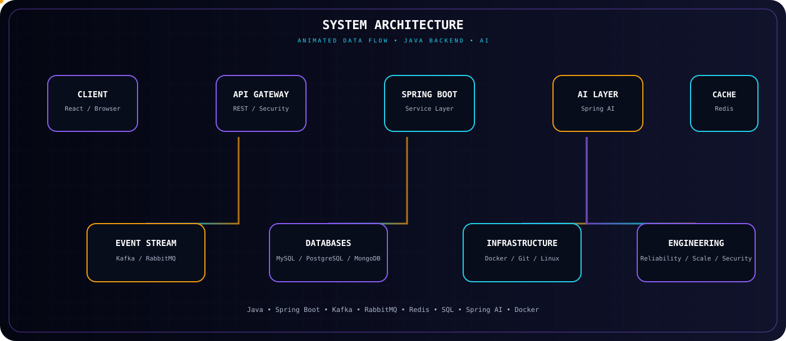
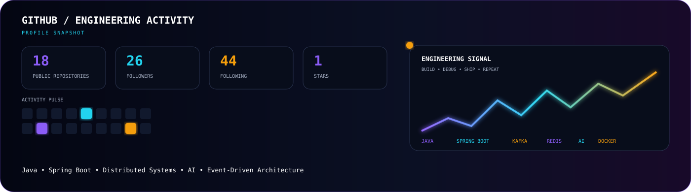

  

  

SYSTEMS • BACKEND • DISTRIBUTED ARCHITECTURE • AI

  
  
  
  

  
  
  

<h2 align="center">01 // About Me</h2>

<table align="center">
<tr>
<td width="50%" valign="top">

<b>public class MaruthiSreeram {</b>

<code>String role = "Java Backend Developer ";</code> 
<code>String education = "B.Tech Computer Science · Class of 2027";</code>

<code>focus = [Backend Engineering, Distributed Systems, Microservices, Event-Driven Architecture, AI Integration]</code>

<code>stack = [Java, Spring Boot, Spring AI, Kafka, RabbitMQ, Redis, MySQL, PostgreSQL, Docker]</code>

<code>learning = "Distributed Systems, System Design &amp; Scalable Backend Architecture";</code> 
<code>building = "Production-oriented backend systems and AI-powered applications";</code> 
<code>goal = "Java Backend Engineer / Software Development Engineer";</code> 
<code>principle = "Understand the system. Build it. Break it. Improve it.";</code>

<b>}</b>

</td>

<td width="50%" valign="top">

<h3 align="center">ENGINEERING MINDSET</h3>

I enjoy understanding what happens behind an API rather than treating frameworks as black boxes. My current engineering direction is centered around Java backend development, Spring Boot, distributed systems, event-driven architectures and practical AI integration.

I build projects to explore real engineering problems: authentication, data persistence, asynchronous processing, caching, service communication, fault tolerance, retrieval systems and scalable application design.

</td>
</tr>
</table>

<h2 align="center">02 // Technical Stack</h2>

<table align="center">
<tr>
<td align="center" width="50%">
<b>Languages</b>  
 
Java · Python · JavaScript
</td>

<td align="center" width="50%">
<b>Backend Engineering</b>  
 
Spring Boot · Hibernate · Spring Data · Maven
</td>
</tr>

<tr>
<td align="center">
<b>Databases &amp; Caching</b>  
 
MySQL · PostgreSQL · MongoDB · Redis
</td>

<td align="center">
<b>Messaging &amp; Streaming</b>  
 
Kafka · RabbitMQ · Event-driven systems
</td>
</tr>

<tr>
<td align="center">
<b>DevOps &amp; Engineering Tools</b>  
 
Docker · Git · GitHub · Postman · Linux
</td>

<td align="center">
<b>Frontend &amp; Development</b>  
 
React · HTML · CSS · IntelliJ IDEA · VS Code
</td>
</tr>
</table>

<h2 align="center">03 // Engineering Focus</h2>

<table align="center">
<tr>
<td width="33%" align="center">
<b>Backend Systems</b>  
REST APIs, authentication, persistence, service-layer design and clean architecture.
</td>

<td width="33%" align="center">
<b>Distributed Systems</b>  
Consensus, replication, concurrency, messaging, caching and fault tolerance.
</td>

<td width="33%" align="center">
<b>AI Engineering</b>  
Spring AI, retrieval, contextual assistants and AI-assisted application workflows.
</td>
</tr>
</table>

Building scalable backend systems with a focus on
<strong>correctness, maintainability, reliability and practical engineering trade-offs.</strong>

<h2 align="center">04 // System Architecture</h2>

<h2 align="center">05 // Featured Projects</h2>

Projects built to explore backend engineering, distributed systems, event-driven architectures and AI-powered applications.

<table align="center">

<tr>
<td width="50%" valign="top">

<h3 align="center">Nexus AI</h3>

AI-powered assistant integrated into a healthcare platform, designed around contextual conversations, intelligent retrieval and workflow-oriented assistance.

<ul>
<li>Context-aware AI conversations</li>
<li>Retrieval-oriented workflows</li>
<li>Spring AI integration</li>
<li>Backend-driven AI features</li>
</ul>

<b>Tech:</b> Java · Spring Boot · Spring AI · React

</td>

<td width="50%" valign="top">

<h3 align="center">Online Medication &amp; Prescription Tracker</h3>

Full-stack healthcare platform for managing prescriptions, medicine reminders and role-based workflows for patients and doctors.

<ul>
<li>JWT authentication</li>
<li>Role-based dashboards</li>
<li>Prescription management</li>
<li>AI-assisted recommendations</li>
</ul>

<b>Tech:</b> Java · Spring Boot · React · MySQL · JWT

</td>
</tr>

<tr>
<td width="50%" valign="top">

<h3 align="center">IPL Live Cricket Dashboard</h3>

Real-time cricket dashboard exploring event-driven architecture, streaming pipelines and fast data access for live match information.

<ul>
<li>Kafka-based event streaming</li>
<li>Redis caching</li>
<li>Real-time updates</li>
<li>Analytics-oriented backend</li>
</ul>

<b>Tech:</b> Java · Spring Boot · Kafka · Redis · MySQL

</td>

<td width="50%" valign="top">

<h3 align="center">Distributed Key-Value Store using Raft</h3>

A systems-oriented project exploring consensus, leader election and replicated state across multiple nodes.

<ul>
<li>Raft consensus algorithm</li>
<li>Leader election</li>
<li>Log replication</li>
<li>Concurrency and fault tolerance</li>
</ul>

<b>Tech:</b> Java · Raft · Sockets · Concurrency

</td>
</tr>

<tr>
<td width="50%" valign="top">

<h3 align="center">Enterprise Knowledge Model</h3>

AI-oriented knowledge platform focused on document ingestion, semantic retrieval and intelligent access to enterprise information.

<ul>
<li>Document ingestion</li>
<li>Semantic search</li>
<li>AI-powered retrieval</li>
<li>Enterprise knowledge workflows</li>
</ul>

<b>Tech:</b> Java · Spring Boot · Spring AI · PostgreSQL · Redis · Kafka

</td>

<td width="50%" valign="top">

<h3 align="center">More Backend Work</h3>

A growing collection of backend experiments covering database access, debugging, financial data processing, real-time processing and application architecture.

<ul>
<li>JDBC and database systems</li>
<li>Real-time order processing</li>
<li>Finance data processing</li>
<li>Java debugging and problem solving</li>
</ul>

<b>Direction:</b> Java · Spring Boot · SQL · Distributed Systems

</td>
</tr>

</table>

<h2 align="center">06 // GitHub Analytics</h2>

<h2 align="center">07 // Connect With Me</h2>

<strong>Building scalable systems. Learning deeply. Engineering with purpose.</strong>

