<p align="center">

</p>

<br>

<p align="center"></p>

<p align="center">
Every app has a hidden half: the servers that store your data, check who you are and keep running when something breaks.<br>
<b>That hidden half is what I build.</b> Java and Spring Boot on the backend, B.Tech Computer Science, class of 2027,<br>
aiming for a Software Development Engineer role.
</p>

<p align="center"></p>

<br>

<p align="center"></p>

<p align="center"></p>

<br>

<p align="center"></p>

<p align="center"></p>

<p align="center">
<a href="https://github.com/maruthi-sreeram-p/careerFlux"><b>Source code</b></a>
&nbsp;·&nbsp;
<a href="https://github.com/maruthi-sreeram-p/careerFlux/blob/main/docs/architecture.md">Architecture notes</a>
</p>

<details>
<summary><b>Run CareerFlux</b> (Java 21, Maven 3.9, Node 20)</summary>

```bash
export CAREERFLUX_JWT_SECRET="$(openssl rand -base64 48)"
cd backend  && mvn spring-boot:run -Dspring-boot.run.profiles=dev,demo   # API on :8080
cd frontend && npm install && npm run dev                                # UI  on :5173
```

Run the test suite: `cd backend && mvn test`

</details>

<br>

<p align="center"></p>

<p align="center">
<a href="https://github.com/maruthi-sreeram-p/medcare-nexus-ai"><b>Source code</b></a>
</p>

<details>
<summary><b>Run Nexus AI</b> (Java 21, Node 20)</summary>

```bash
cd backend  && mvn spring-boot:run          # API on :8088, Swagger UI at /swagger-ui.html
cd frontend && npm install && npm run dev   # UI  on :3000
```

Open `http://localhost:8088/swagger-ui.html` and call the same endpoint as two different roles to see access control at work.

</details>

<br>

<p align="center"></p>

<p align="center">
<a href="https://github.com/maruthi-sreeram-p/online-medication-and-prescription-tracker"><b>Source code</b></a>
</p>

<details>
<summary><b>Run MediCare Tracker</b> (three terminals, MySQL running first)</summary>

```bash
mvn spring-boot:run                        # backend, :8321
uvicorn main:app --reload --port 8000      # AI service, :8000
npm install && npm start                   # frontend, :3000
```

</details>

<!-- TODO(maruthi): add a "verify" line for MediCare, e.g. one request/response showing a dose moving from PENDING to LATE. -->

<br>

<p align="center"></p>

<!-- TODO(maruthi): add the repo link and the one command that starts the cluster, then uncomment:

<p align="center">
<a href="https://github.com/maruthi-sreeram-p/REPO-NAME"><b>Source code</b></a>
</p>

<details>
<summary><b>Run the 3-node cluster</b></summary>

```bash
# command that starts the cluster
# steps: kill the leader, watch the election, confirm a write still replicates
```

</details>
-->

<br>

<p align="center"></p>

<p align="center">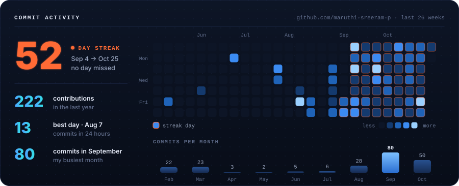</p>

<p align="center"><sub>Drawn from my real GitHub contributions and refreshed daily by a GitHub Action.</sub></p>

<br>

<p align="center"></p>

<p align="center"></p>

<p align="center">
<a href="https://github.com/maruthi-sreeram-p/java-debugging-playground"><b>java-debugging-playground</b></a>
&nbsp;·&nbsp;
<a href="https://github.com/maruthi-sreeram-p/spring-boot-debugging-laboratory"><b>spring-boot-debugging-laboratory</b></a>
</p>

<details>
<summary><b>Start a lab</b></summary>

```bash
# java-debugging-playground (JDK 17+, Docker from project 05)
cd 05-mysql-integration-debugging && docker compose up -d

# spring-boot-debugging-laboratory
docker compose -f infra/docker-compose.yml up -d mysql redis
```

</details>

<br>

<p align="center"></p>

<p align="center">
<a href="https://maruthi-sreeram.vercel.app/"></a>
<a href="https://www.linkedin.com/in/maruthi-sreeram-b57680331/"></a>
<a href="https://leetcode.com/u/PMaruthisreeram/"></a>
<a href="https://github.com/maruthi-sreeram-p"></a>
<a href="mailto:maruthisreeram864@gmail.com"></a>
</p>

<p align="center"></p>
